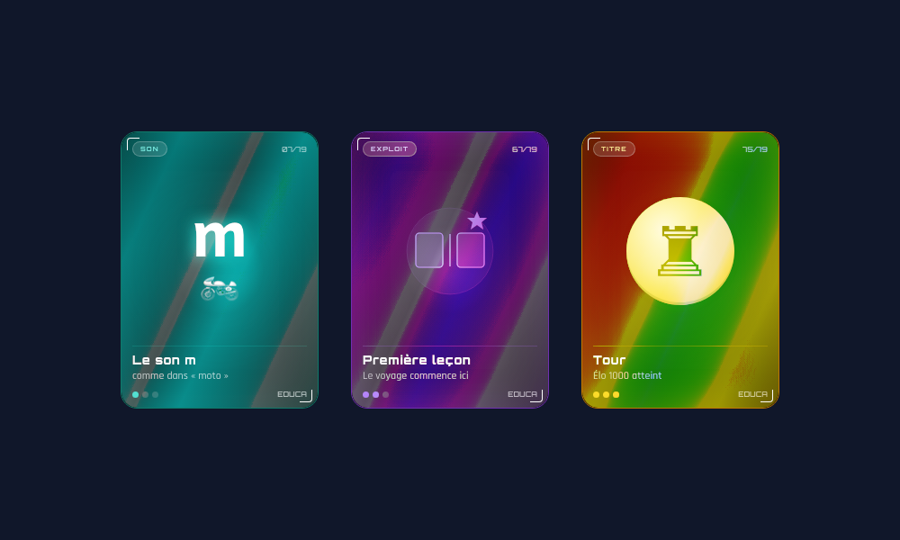
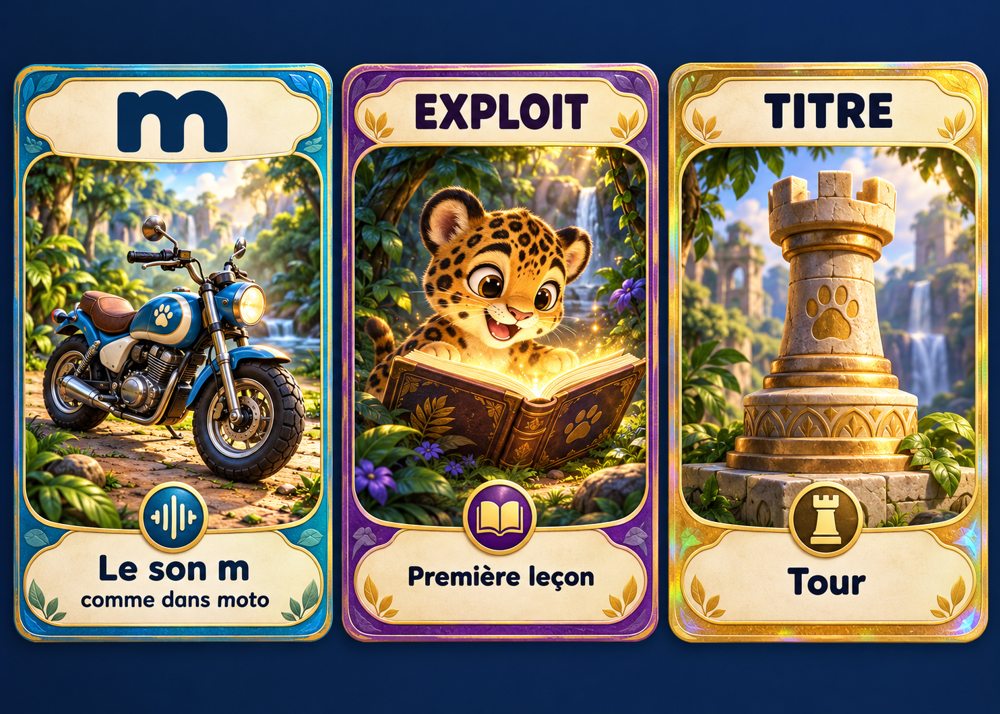

# Design d’EDUCA et proposition de cartes illustrées

25 octobre 2026. Demande : rendre les cartes plus visuelles à l’aide d’un générateur d’images. Cette proposition complète [l’audit du projet](../../audits/2026-10-25/AUDIT.md).

## Ce qui a été examiné

Lecture de `js/ui/cards.js`, `css/cards.css`, `js/screens/collection.js` et des règles de gain ; inspection de l’accueil mobile et rendu de trois faces de cartes à partir du code existant. Le catalogue actuel compte 83 cartes : 66 étapes, 6 exploits, 7 titres et 4 diplômes.

Les cartes possèdent déjà un retournement, une inclinaison, des reflets holographiques et des familles de couleurs. Le saut à faire concerne surtout l’illustration, la lisibilité et l’identité de la collection.

### Rendu de référence des faces actuelles

Ce rendu assemble les faces pour comparaison ; ce n’est pas une capture de toute la révélation interactive. Il utilise les données et styles existants, sans modifier le jeu.

## Analyse du design

L’accueil est chaleureux, avec une action principale facile à repérer. Les cartes utilisent davantage une esthétique sombre et technologique, notamment les polices Orbitron et Rajdhani, alors que le jeu est guidé par un bébé jaguar. Une direction commune autour de Kaya peut mieux relier l’accueil et les récompenses.

Les visuels actuels occupent relativement peu de place : lettre + émoji, symbole d’exploit ou pièce d’échecs. La collection utilise de petites cases d’environ 82 pixels minimum : une carte possédée ressemble surtout à un symbole et un nom, ce qui donne peu à découvrir visuellement.

Les petits textes des cartes sont à 7–13 pixels selon leur rôle. Réserver les petites tailles aux informations secondaires, rendre le titre vraiment lisible et utiliser Andika pour les graphèmes. Le décor, le reflet et la typographie doivent laisser la priorité au son appris et à l’image associée.

Les révélations peuvent conserver leur retournement et un reflet discret. Limiter le mouvement permanent et respecter la réduction des animations. Le focus visible est actuellement supprimé sur `.card-wrap:focus-visible` ; il doit rester repérable au clavier. Corriger aussi le comportement modal décrit dans l’audit, et afficher les diplômes dans la collection.

## Direction proposée : une collection illustrée autour de Kaya

La planche présente trois familles déjà présentes dans le jeu :

| Famille | Exemple | Direction visuelle |
| --- | --- | --- |
| Sons | `son-m` : m / moto | Objet du mot d’appui clairement reconnaissable, graphème très visible, cadre bleu/vert |
| Exploits | `r_first` : Première leçon | Kaya dans une scène narrative liée à l’apprentissage, cadre violet |
| Titres | `titre-tour` : Tour | Pièce d’échecs sculptée, identifiable, cadre doré |
| Diplômes | Contrôle réussi | Scène de célébration et diplôme lisible, à produire ensuite dans la même famille |

Les illustrations ont été générées avec l’outil d’image intégré. La planche est une proposition graphique. Les lettres et les mots de cette planche ne doivent pas être utilisés comme source de texte de l’application : le rendu final doit les produire en HTML avec les polices du jeu.

Le style proposé associe une illustration 3D de conte, des matières détaillées, une lumière chaude et des cadres sobres. Il reste à tester en petite vignette : les détails des feuillages peuvent être simplifiés pour que le sujet domine. Le graphème `m` de la maquette doit notamment être remplacé par celui de la police Andika en code.

## Deux illustrations sources déjà disponibles

Pour permettre un vrai prototype, deux images ont aussi été générées séparément sans textes ni cadres :

- [Moto pour `son-m`](images/son-m-moto-source-v1.png)
- [Kaya lisant pour `r_first`](images/exploit-premiere-lecon-source-v1.png)

Elles sont au format portrait 5:7. Ce sont des PNG sources à optimiser et à cadrer pour le composant final. Les conserver comme originaux ; produire des fichiers WebP adaptés aux cartes et des vignettes séparées. La proposition de Tour existe pour le moment dans la planche, pas encore comme illustration isolée.

Les prompts exacts et les rôles des images de référence sont conservés dans [PROMPTS_IMAGES.md](PROMPTS_IMAGES.md). Le visuel de Kaya est une nouvelle interprétation : le comparer avec la mascotte du jeu et stabiliser une fiche de personnage avant la production de toute la collection.

## Règles d’intégration

1. **L’image est générée à l’avance.** Le jeu télécharge ses fichiers statiques ; il n’appelle aucun service de génération pendant la partie et ne transmet aucune donnée d’enfant.
2. **Le texte reste natif.** Graphème, titre, mot d’appui, condition de gain et compteur sont rendus par le code. Pas de texte pédagogique incorporé dans le bitmap final.
3. **Les identifiants et les gains restent stables.** `son-m`, `r_first`, etc. gardent leurs conditions. Une image nouvelle ne doit pas faire perdre les cartes anciennes.
4. **Les visuels ont un manifeste.** Chaque illustration référence un identifiant de carte, un fichier principal, une vignette, une description, son prompt et sa version. L’absence d’image conserve un rendu de secours fonctionnel.
5. **Le son garde son association correcte.** Lire le mot d’appui des données, plutôt que l’inventer. Certaines étapes ont une règle ou des exemples et aucun objet unique : leur composition devra être traitée séparément.
6. **La miniature montre l’illustration.** Prévoir un cadrage simple et cohérent, des états acquis/à découvrir compréhensibles et une ouverture au clavier. Ne pas se contenter d’afficher une image uniquement dans la grande révélation.
7. **Le cache et le build doivent inclure les vrais fichiers d’exécution.** Si le prototype place les images dans `assets/cards/`, ajouter explicitement ce dossier au build et à la politique hors ligne. Ces sources dans `docs/` restent des documents et ne doivent pas être chargées par le jeu de production.

## Performance et hors ligne

L’application actuelle a un corpus audio léger. Une collection de 83 PNG haute résolution alourdirait fortement l’installation. Valeurs de départ proposées, à mesurer sur le prototype : vignette autour de 10–25 Ko ; grande illustration autour de 80–150 Ko ; dimensions correspondant à l’affichage et à la densité d’écran, avec originaux conservés hors du paquet du jeu.

Charger les vignettes avec dimensions explicites et chargement différé ; charger la grande image à l’ouverture. Cela ne réduit pas le téléchargement d’installation si le service worker précache tout : définir séparément le noyau indispensable et, si nécessaire, un paquet de collection dont l’état hors ligne est présenté à l’adulte. Ne pas promettre une collection hors ligne complète avant son téléchargement réel.

Tester d’abord deux cartes, puis un petit lot représentatif. Vérifier le temps d’ouverture, le poids des images, le fonctionnement sans réseau, le retour, le focus et la réduction des mouvements avant de produire les 83 visuels.

## Consigne de suite

La demande d’intégration prête à copier est dans [PROMPT_CODEX.md](PROMPT_CODEX.md). Les cartes de l’application n’ont pas encore été remplacées. Cette livraison ajoute une direction artistique, une maquette et deux sources d’illustration exploitables pour le prototype suivant.
